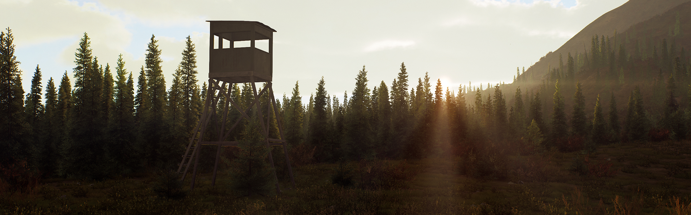
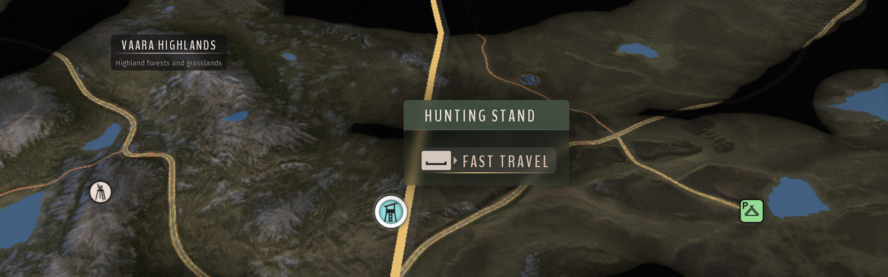
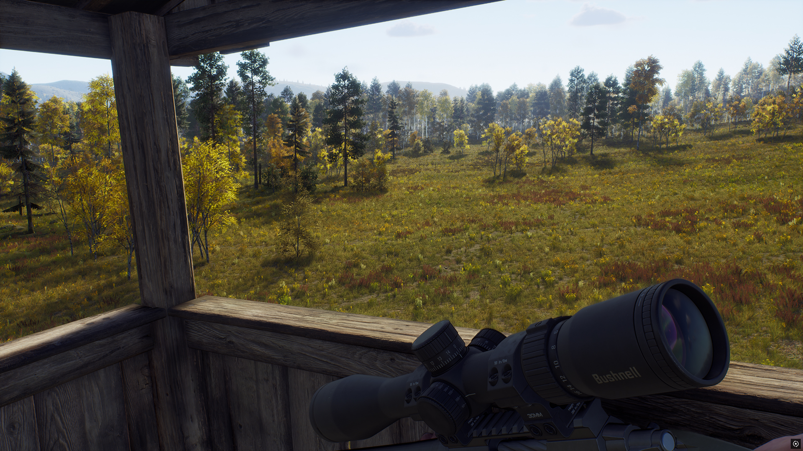
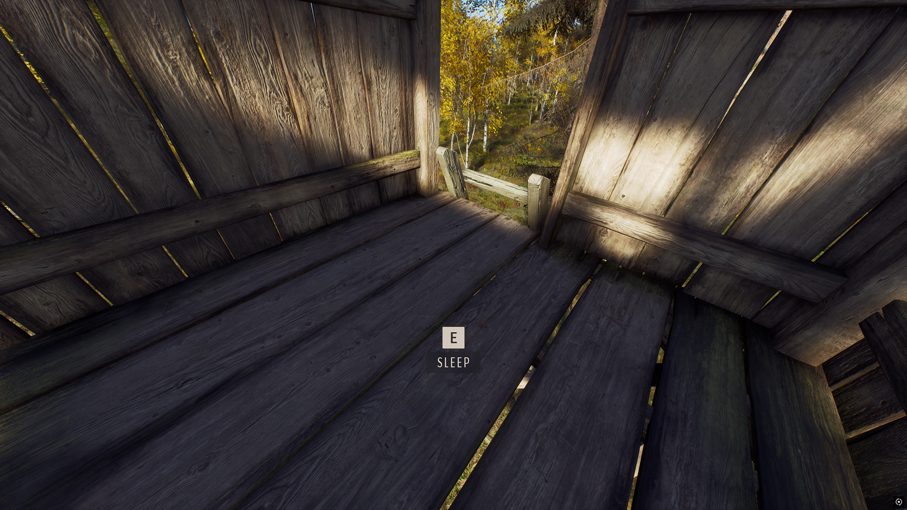

# Hunting Stand Rework — Way of the Hunter Mod

Fast travel directly onto discovered permanent hunting stands in Way of the Hunter and skip time from their upper platforms.

## Description

A hunting stand is a useful place to wait, but getting back to it and passing time can interrupt the hunt you have planned. Hunting Stand Rework lets you **travel straight onto a discovered permanent stand** and open the **rest menu without leaving the platform**. You can settle into your chosen position and wait for the right time there.

## Download & Install

You can download the mod from my [Website](https://mahpella.com/games/way-of-the-hunter/mods/hunting-stand-rework) or [Nexus Mods](https://www.nexusmods.com/wayofthehunter/mods/37).

### Step 1. Create a backup (optional)

If you wish, copy the **Saved** folder to another location:  
**Win + R → `%LOCALAPPDATA%\WayOfTheHunter`**

### Step 2. Open the game folder

Close the game. In Steam, browse the local files for Way of the Hunter and open:  
`WayOfTheHunter\Content\Paks`

### Step 3. Install the mod

Extract the archive and copy all **.pak files** into the **Paks** folder, replacing older versions if necessary. Launch the game and load your save.

## How to Use

- Select a **discovered hunting stand** on the map and use the normal **Fast Travel action**.
- You arrive inside its upper platform. Allow about one second for the rest interaction to become available.

- Look at the **platform floor** and use the Sleep interaction shown by the game.
- Choose a rest duration or cancel the menu. Rest also works after climbing the ladder normally.

> Mobile stands, tripods, undiscovered stands, the ground and ladders are outside this feature’s scope.

## Best Mod Combos

To make Hunting Stand Rework part of a planned hunt, I recommend this combination.

1. [72-Hour Sleep](https://mahpella.com/games/way-of-the-hunter/mods/sleep-timeline) — if you want longer rests, this optional mod extends the rest menu to 72 hours and allows consecutive sleeps. Open that menu from the stand’s floor, choose your duration and stay at your chosen position.
2. [Better Need Zones](https://www.nexusmods.com/wayofthehunter/mods/31) — check the zones and usage times around your chosen position, then select a discovered permanent stand nearby.
3. [Herd Tracker](https://www.nexusmods.com/wayofthehunter/mods/28) — favorite the herd you want to follow and check its species’ HUD schedule. Travel onto the stand and use that schedule to decide when to rest.

## Feedback

If you find a bug, have suggestions for improving this mod, or have ideas for new mods, I would love to hear from you.

More useful interface and UX mods at my website: [mahpella.com](https://mahpella.com).

If you would like to support my work →  
[Buy Me a Coffee](https://buymeacoffee.com/mahpella) or [PayPal.me](https://paypal.me/bymahpella).